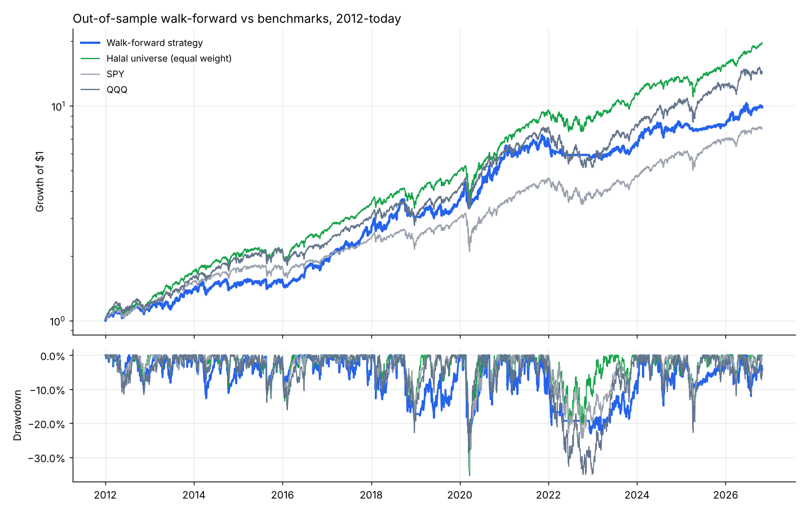
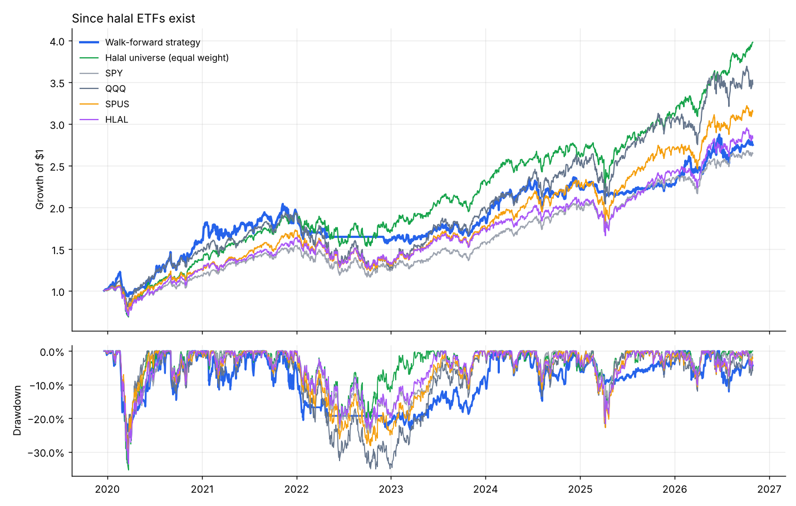

# Halal Quant Lab - Research Report

Generated 2026-10-30. Data: Yahoo Finance daily bars, 2005-01-03 to 2026-10-29.
Costs: 5 bps per side (commission + slippage). Signals at close, trades next day.

> **Not financial advice.** Backtests describe the past. The universe is today's halal list, which
> includes only survivors (stocks that did well enough to still be large today). That inflates every
> number in this report, including the equal-weight universe benchmark - so compare the strategy
> against **that** benchmark, not just SPY.

## 1. Universe
128 of 156 candidate US large caps pass the AAOIFI-style screen (business activity +
debt/market cap < 30% + cash/market cap < 30%). Full list and rejection reasons: `universe_screen.csv`.

## 2. The honest number: walk-forward out-of-sample
2000 strategy configs were generated (1000 rotation, 1000 swing confluence), each
combining several concepts (trend, momentum, relative strength, RSI pullbacks, Bollinger dips, Donchian
breakouts, volume/OBV accumulation, low volatility, ADX trend strength, SPY/VIX market regime).
Each year from 2012, the top 3 configs by Sharpe over the **previous 5 years only**
(rejecting train drawdowns worse than -35%) are blended equally and traded for that year.

| Series | From | CAGR | Volatility | Sharpe | Sortino | Max drawdown | Calmar |
|---|---|---|---|---|---|---|---|
| Walk-forward strategy | 2012-01-03 | 16.7% | 18.0% | 0.95 | 1.23 | -23.8% | 0.70 |
| Halal universe (equal weight) | 2012-01-03 | 22.3% | 18.2% | 1.20 | 1.52 | -35.4% | 0.63 |
| SPY | 2012-01-03 | 15.0% | 16.5% | 0.93 | 1.15 | -33.7% | 0.44 |
| QQQ | 2012-01-03 | 19.7% | 20.5% | 0.98 | 1.26 | -35.1% | 0.56 |

**Verdict:** the walk-forward strategy returned 16.7%/yr with a -23.8% max drawdown,
vs SPY 15.0%/yr (-33.7%) and the equal-weight halal universe 22.3%/yr
(-35.4%). Sharpe: strategy 0.95, SPY 0.93, halal EW 1.20.

**Cost stress test** (same picks, 3x costs = 15 bps/side): CAGR 13.8%,
Sharpe 0.81.

### Year by year
| | Walk-forward strategy | Halal universe (equal weight) | SPY | QQQ | Strategy minus SPY |
|---|---|---|---|---|---|
| 2012 | 12.1% | 20.6% | 16.0% | 18.1% | -3.9% |
| 2013 | 25.7% | 42.1% | 32.3% | 36.6% | -6.6% |
| 2014 | 5.7% | 19.5% | 13.5% | 19.2% | -7.8% |
| 2015 | 2.6% | 3.4% | 1.2% | 9.4% | 1.3% |
| 2016 | 24.3% | 23.0% | 12.0% | 7.1% | 12.3% |
| 2017 | 35.3% | 33.0% | 21.7% | 32.7% | 13.6% |
| 2018 | 18.5% | 3.5% | -4.6% | -0.1% | 23.0% |
| 2019 | 19.3% | 38.9% | 31.2% | 39.0% | -11.9% |
| 2020 | 59.6% | 37.3% | 18.3% | 48.4% | 41.3% |
| 2021 | 20.1% | 39.1% | 28.7% | 27.4% | -8.6% |
| 2022 | -16.7% | -10.3% | -18.2% | -32.6% | 1.4% |
| 2023 | 16.5% | 34.2% | 26.2% | 54.9% | -9.7% |
| 2024 | 18.1% | 12.6% | 24.9% | 25.6% | -6.8% |
| 2025 | 2.0% | 18.5% | 17.7% | 20.8% | -15.7% |
| 2026 | 21.2% | 28.6% | 13.6% | 14.9% | 7.6% |

## 3. Versus real halal ETFs (since 2019-12)
| Series | From | CAGR | Volatility | Sharpe | Sortino | Max drawdown | Calmar |
|---|---|---|---|---|---|---|---|
| Walk-forward strategy | 2019-12-20 | 15.9% | 19.8% | 0.84 | 1.09 | -23.8% | 0.67 |
| Halal universe (equal weight) | 2019-12-20 | 22.4% | 21.5% | 1.04 | 1.31 | -35.4% | 0.63 |
| SPY | 2019-12-20 | 15.3% | 19.9% | 0.81 | 1.01 | -33.7% | 0.45 |
| QQQ | 2019-12-20 | 20.0% | 24.7% | 0.86 | 1.14 | -35.1% | 0.57 |
| SPUS | 2019-12-20 | 18.3% | 21.0% | 0.90 | 1.20 | -30.8% | 0.59 |
| HLAL | 2019-12-20 | 16.5% | 20.3% | 0.85 | 1.08 | -33.6% | 0.49 |

## 4. What the search learned - which concepts helped?
Average full-period Sharpe of configs that used each concept vs configs that did not:

| Family | Concept | Avg Sharpe WITH | Avg Sharpe WITHOUT | Difference |
|---|---|---|---|---|
| swing | rel_strength | 0.57 | 0.49 | +0.08 |
| swing | momentum | 0.55 | 0.51 | +0.04 |
| rotation | lowvol | 0.78 | 0.75 | +0.02 |
| swing | volume | 0.54 | 0.52 | +0.02 |
| rotation | short | 0.77 | 0.76 | +0.02 |
| swing | market regime filter | 0.54 | 0.52 | +0.02 |
| rotation | mom | 0.77 | 0.76 | +0.01 |
| rotation | strength | 0.77 | 0.77 | +0.01 |
| swing | strong | 0.53 | 0.53 | +0.00 |
| rotation | dip | 0.77 | 0.77 | -0.01 |
| swing | pullback | 0.53 | 0.54 | -0.01 |
| rotation | market regime filter | 0.76 | 0.80 | -0.04 |
| swing | bb_dip | 0.51 | 0.57 | -0.06 |
| swing | breakout | 0.50 | 0.58 | -0.07 |

Median of all configs by family:

| | cagr | sharpe | max_dd |
|---|---|---|---|
| rotation | 0.11 | 0.77 | -0.28 |
| swing | 0.09 | 0.56 | -0.30 |

## 5. In-sample leaderboard (overfit - do not trust these numbers)
The best of 2000 configs over the whole history. Picking the max of many tries is exactly how
overfitting happens. **Deflated Sharpe Ratio of #1: 0.93** (probability its Sharpe is skill, not luck,
after accounting for 2000 trials; >0.95 is convincing).

| # | Family | CAGR | Sharpe | Max DD | Description |
|---|---|---|---|---|---|
| 647 | rotation | 12.2% | 1.06 | -19.5% | ROTATION top15 M invvol | score=momx0.5+shortx1+lowvolx2+strengthx1 mom252 | trend>SMA100 | regime SPY>SMA200 VIX<100 |
| 1962 | swing | 18.5% | 1.05 | -27.2% | SWING max8 | vote(strongx2+rel_strengthx1+pullbackx1+bb_dipx1+breakoutx2+volumex1)>=70% trend>SMA150 | exit ATRx5, 120d, <SMA100 | regime SPY>SMA150 VIX<100 |
| 40 | rotation | 15.0% | 1.04 | -19.8% | ROTATION top15 M equal | score=shortx1+lowvolx0.5+strengthx0.5+dipx0.5 mom252 | trend>SMA200 | regime SPY>SMA200 VIX<40 |
| 456 | rotation | 14.4% | 1.03 | -19.9% | ROTATION top10 M equal | score=momx0.5+shortx2+lowvolx2+strengthx2+dipx2 mom126 | trend>SMA100 | regime SPY>SMA150 VIX<100 |
| 796 | rotation | 18.6% | 1.03 | -27.6% | ROTATION top5 M equal | score=momx0.5+shortx2+lowvolx1+strengthx2+dipx2 mom189 | trend>SMA200 | regime SPY>SMA200 VIX<100 |
| 1053 | swing | 17.7% | 1.03 | -28.9% | SWING max10 | vote(pullbackx1+bb_dipx2+breakoutx1)>=40% trend>SMA100 | exit ATRx3, 40d, <SMA100 | regime SPY>SMA100 VIX<100 |
| 49 | rotation | 13.3% | 1.02 | -19.3% | ROTATION top10 M equal | score=momx0.5+shortx2+lowvolx2+strengthx1+dipx1 mom189 | trend>SMA150 | regime SPY>SMA200 VIX<100 |
| 394 | rotation | 11.6% | 1.02 | -20.7% | ROTATION top8 M equal | score=lowvolx0.5+strengthx0.5 mom252 | trend>SMA100 | regime SPY>SMA150 VIX<40 |
| 122 | rotation | 11.5% | 1.01 | -16.7% | ROTATION top8 M equal | score=momx0.5+shortx0.5+lowvolx2+strengthx0.5 mom252 | trend>SMA150 | regime SPY>SMA200 VIX<100 |
| 350 | rotation | 12.8% | 1.01 | -20.1% | ROTATION top15 M equal | score=momx2+lowvolx2+strengthx1 mom189 | trend>SMA100 | regime SPY>SMA200 VIX<40 |
| 282 | rotation | 19.1% | 1.01 | -33.2% | ROTATION top5 M invvol | score=momx0.5+shortx1+lowvolx1+dipx2 mom252 | trend>SMA100 |
| 514 | rotation | 15.1% | 1.00 | -26.3% | ROTATION top5 M equal | score=momx1+shortx2+lowvolx2+strengthx1+dipx2 mom126 | trend>SMA100 | regime SPY>SMA150 VIX<100 |
| 732 | rotation | 19.0% | 1.00 | -28.7% | ROTATION top20 M equal | score=momx2+shortx2+strengthx0.5+dipx0.5 mom126 | trend>SMA100 | regime SPY>SMA200 VIX<100 |
| 1995 | swing | 29.0% | 1.00 | -50.8% | SWING max5 | vote(strongx1+momentumx1+pullbackx2+bb_dipx2+breakoutx2)>=40% | exit ATRx3, 120d, <SMA100 |
| 297 | rotation | 15.6% | 0.99 | -25.6% | ROTATION top20 M invvol | score=momx2+shortx1+lowvolx0.5+strengthx1+dipx1 mom189 | trend>SMA100 | regime SPY>SMA200 VIX<40 |

## 6. Current strategy (chosen with data up to 2026-10-29)
Configs selected by the latest walk-forward window (2021-2025):

- `#697` ROTATION top8 M invvol | score=momx2+shortx1+lowvolx0.5+strengthx1+dipx0.5 mom126 | trend>SMA50
- `#1443` SWING max10 | vote(pullbackx1+bb_dipx2)>=60% trend>SMA50 | exit ATRx2, 10d, <SMA50 | regime SPY>SMA150 VIX<100
- `#1474` SWING max8 | vote(strongx1+rel_strengthx1+pullbackx2+volumex1)>=60% trend>SMA50 | exit ATRx5, 10d, <SMA100 | regime SPY>SMA200 VIX<100

Blended current holdings (share of portfolio):

- TMO: 9.9%
- MPC: 8.4%
- A: 5.6%
- PSX: 5.2%
- IT: 4.4%
- LLY: 4.4%
- VLO: 4.3%
- CTAS: 4.1%
- XOM: 4.1%
- COP: 4.1%
- MSFT: 3.8%
- ADI: 3.7%
- WST: 3.7%
- DDOG: 3.4%
- FTNT: 2.6%
- DELL: 1.6%

Full parameters: `current_configs.json`. Per-config holdings: `current_signals.csv`.

## 7. Files
- `all_configs.csv` - every config with full-period stats
- `walkforward_choices.csv` - which configs were picked each year and how they did out-of-sample
- `universe_screen.csv` - halal screen results
