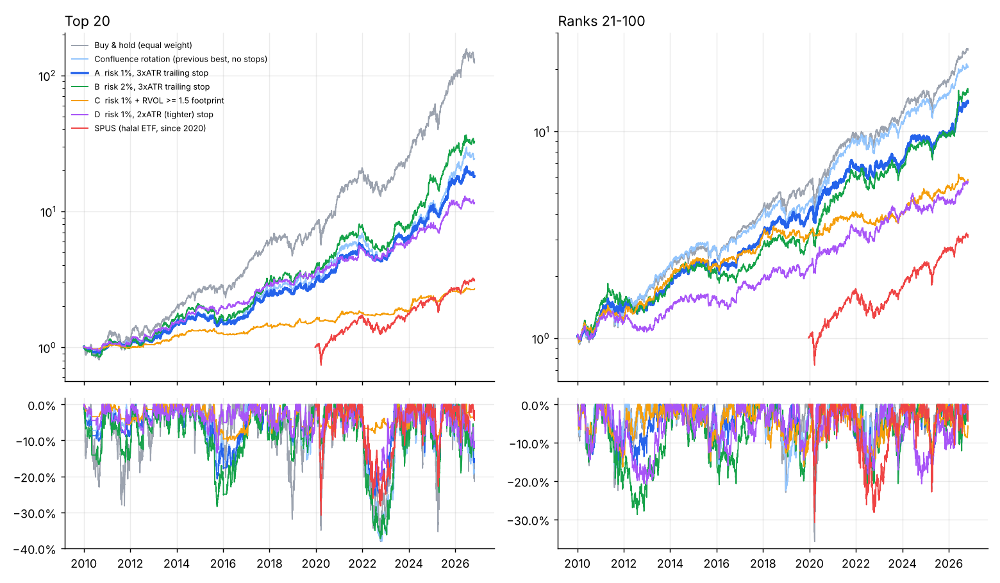

# Risk-managed halal confluence strategy (daily)

Generated 2026-10-31. Signals: our Confluence strategy without the market filter (see `reports/tv/REPORT.md`). Long-only, no leverage, next-open execution, 5 bps per side, cash earns 0%.
Cells: CAGR / Sharpe / max drawdown.

## Top 20

| Strategy | 2010-2018 | 2019-today | 2010-today | Avg invested | Trades | Win rate |
|---|---|---|---|---|---|---|
| Buy & hold (equal weight) | 19.8% / 0.91 / -32% | 50.4% / 1.41 / -38% | 33.2% / 1.17 / -38% | 100% |  |  |
| Confluence rotation (previous best, no stops) | 11.7% / 0.97 / -19% | 32.5% / 1.30 / -38% | 20.9% / 1.12 / -38% | 66% |  |  |
| A  risk 1%, 3xATR trailing stop | 10.7% / 0.88 / -21% | 28.9% / 1.38 / -26% | 18.8% / 1.14 / -26% | 61% | 774 | 48% |
| B  risk 2%, 3xATR trailing stop | 13.1% / 0.84 / -28% | 35.5% / 1.41 / -37% | 23.1% / 1.14 / -37% | 70% | 577 | 47% |
| C  risk 1% + RVOL >= 1.5 footprint | 3.9% / 0.71 / -10% | 8.6% / 0.97 / -10% | 6.1% / 0.84 / -10% | 23% | 234 | 51% |
| D  risk 1%, 2xATR (tighter) stop | 12.5% / 1.06 / -14% | 19.4% / 1.09 / -23% | 15.7% / 1.06 / -23% | 52% | 772 | 47% |
| SPUS (halal ETF, since 2020) | 0.0% / 0.00 / 0% | 17.9% / 0.89 / -31% | 17.9% / 0.89 / -31% | 100% |  |  |

### Monthly returns - reality check vs a 25-50%/month target

| Strategy | Median month | Best month | Worst month | Months >= +10% | Months >= +25% | Up months |
|---|---|---|---|---|---|---|
| Buy & hold (equal weight) | 3.6% | 29.8% | -16.3% | 10% | 1% | 65% |
| Confluence rotation (previous best, no stops) | 1.5% | 21.3% | -13.0% | 5% | 0% | 62% |
| A  risk 1%, 3xATR trailing stop | 1.4% | 25.7% | -10.2% | 4% | 0% | 58% |
| B  risk 2%, 3xATR trailing stop | 1.4% | 27.7% | -14.2% | 7% | 0% | 58% |
| C  risk 1% + RVOL >= 1.5 footprint | 0.2% | 13.3% | -4.4% | 0% | 0% | 55% |
| D  risk 1%, 2xATR (tighter) stop | 0.4% | 19.6% | -7.6% | 3% | 0% | 57% |
| SPUS (halal ETF, since 2020) | 1.9% | 13.0% | -9.1% | 4% | 0% | 63% |

## Ranks 21-100

| Strategy | 2010-2018 | 2019-today | 2010-today | Avg invested | Trades | Win rate |
|---|---|---|---|---|---|---|
| Buy & hold (equal weight) | 17.4% / 0.99 / -23% | 25.4% / 1.18 / -36% | 21.1% / 1.08 / -36% | 100% |  |  |
| Confluence rotation (previous best, no stops) | 15.5% / 0.97 / -23% | 24.9% / 1.30 / -20% | 19.8% / 1.13 / -23% | 98% |  |  |
| A  risk 1%, 3xATR trailing stop | 14.8% / 1.02 / -16% | 19.4% / 1.12 / -19% | 16.9% / 1.07 / -19% | 89% | 1145 | 47% |
| B  risk 2%, 3xATR trailing stop | 12.2% / 0.78 / -29% | 24.4% / 1.22 / -22% | 17.7% / 1.00 / -29% | 91% | 809 | 45% |
| C  risk 1% + RVOL >= 1.5 footprint | 13.2% / 1.07 / -16% | 8.7% / 0.72 / -14% | 11.1% / 0.91 / -16% | 69% | 751 | 47% |
| D  risk 1%, 2xATR (tighter) stop | 7.9% / 0.60 / -21% | 14.5% / 0.86 / -21% | 10.9% / 0.73 / -21% | 83% | 1364 | 42% |
| SPUS (halal ETF, since 2020) | 0.0% / 0.00 / 0% | 17.9% / 0.89 / -31% | 17.9% / 0.89 / -31% | 100% |  |  |

### Monthly returns - reality check vs a 25-50%/month target

| Strategy | Median month | Best month | Worst month | Months >= +10% | Months >= +25% | Up months |
|---|---|---|---|---|---|---|
| Buy & hold (equal weight) | 1.8% | 15.2% | -13.8% | 4% | 0% | 67% |
| Confluence rotation (previous best, no stops) | 2.0% | 13.5% | -14.0% | 3% | 0% | 67% |
| A  risk 1%, 3xATR trailing stop | 1.4% | 13.8% | -9.0% | 3% | 0% | 64% |
| B  risk 2%, 3xATR trailing stop | 1.6% | 20.6% | -9.7% | 3% | 0% | 59% |
| C  risk 1% + RVOL >= 1.5 footprint | 0.7% | 10.6% | -7.4% | 0% | 0% | 58% |
| D  risk 1%, 2xATR (tighter) stop | 0.6% | 14.7% | -8.2% | 1% | 0% | 58% |
| SPUS (halal ETF, since 2020) | 1.9% | 13.0% | -9.1% | 4% | 0% | 63% |

## Estimated dividend purification (top 20)
Purify = dividend received x (interest income / total revenue), the main non-permissible income source of screened companies. Estimate only - use your screener's reported purification ratio when available.

| Ticker | Dividend yield | Non-permissible income share | Purify per $10,000 held, per year |
|---|---|---|---|
| MU | 0.06% | 0.81% | $0.05 |
| WDC | 0.18% | 0.39% | $0.07 |
| NVDA | 0.47% | 1.07% | $0.50 |
| STX | 0.43% | 0.25% | $0.11 |
| PLTR | 0.00% | 5.12% | $0.00 |
| LRCX | 0.52% | 0.84% | $0.44 |
| AVGO | 0.75% | 0.54% | $0.41 |
| ANET | 0.00% | 4.26% | $0.00 |
| GEV | 0.23% | 1.20% | $0.27 |
| KLAC | 0.55% | 1.30% | $0.72 |
| APP | 0.00% | 0.00% | $0.00 |
| LLY | 0.50% | n/a | n/a |
| FIX | 0.30% | 0.24% | $0.07 |
| TER | 0.18% | 0.49% | $0.09 |
| FTNT | 0.00% | 2.39% | $0.00 |
| AAPL | 0.31% | n/a | n/a |
| HWM | 0.27% | 0.24% | $0.07 |
| AMAT | 0.50% | 4.41% | $2.20 |
| GOOGL | 0.31% | 1.08% | $0.33 |
| APH | 0.73% | 0.00% | $0.00 |

> Note on the inputs: NVDA's 1.07% and similar figures are interest income / revenue. **PLTR (5.1%), AMAT (4.4%) and
> ANET (4.3%) are at or near the AAOIFI 5% non-permissible income limit** - check them with a Shariah screener before holding.

---

# Strategy dossier: Halal Trend-Confluence with ATR risk (variant A)

## 1. Alpha hypothesis
Let r(i,t) be stock i's return. The edge we can measure is **time-series momentum with volatility-adaptive
regime detection**, conditional on entries that buy pullbacks or volatility expansions inside an established trend:

  E[ r(i,t+1..t+h) | S(i,t)=1 ] > E[ r(i,t+1..t+h) ],  where
  S(i,t) = 1{ SuperTrend_kmeans(i,t) bullish } x 1{ flip(i,t) OR squeeze_release(i,t) OR OB/FVG_retest(i,t) }

Position size w(i,t) = min( rho / (k * ATR14(i,t) / P(i,t)), w_max ), with rho = 1% risk and k = 3, so a stop-out costs
about rho of equity. Exit when P < max(P since entry) - k*ATR, or the regime flips, or a bearish CHoCH prints.

**Measured (ranks 21-100, never used to design the rules), 2010-today:** 16.9%/yr, Sharpe 1.07, max drawdown -19% vs
buy & hold 21.1%, 1.08, -36%. The edge is **drawdown control at a similar Sharpe**, not excess return.

## 2. Institutional footprint rule (tested)
Relative volume RVOL = V(t) / mean(V, 20 days before t) >= 1.5 on the signal day (block-trade / accumulation proxy).
**Result: it made things worse** (top 20: Sharpe 0.84 vs 0.88/1.14; ranks 21-100: 0.91 vs 1.07) because it filters out
most valid trend entries. Dark-pool prints, 13F momentum and options sweeps were not testable with available data, and
the academic evidence for them is weak (13F data is 45 days stale; "best ideas" did not outperform).

## 3. Code
- Python backtest: `lab/risk_engine.py` (engine + purification), `run_halal_alpha.py` (this report), signals in `lab/tv.py`.
- TradingView: `pine/halal_confluence_strategy.pine` (Pine v6, single-symbol version; not yet compiled in TradingView,
  so expect possible minor syntax fixes). Use it on the **daily** chart.

## 4. Failure mode analysis
| Failure mode | When it happens | Evidence in our tests |
|---|---|---|
| Whipsaw in sideways markets | Range-bound years (2011, 2015, 2018) | 2010-2018 Sharpe 0.88 vs 1.38 after 2019 (top 20) |
| Gap risk through stops | Earnings gaps, news shocks | Worst month -10% despite 1% risk per trade (stops fill at the open) |
| Cash drag in V-shaped rebounds | 2020 Mar-Apr, 2025 Apr | Return trails buy & hold most in fast recoveries |
| Concentration in one theme | Semiconductors = ~half the top 20 | Correlated stop-outs on sector selloffs |
| Overfitting / hindsight universe | Top 20 chosen by past 5-year return | Buy & hold of the top 20 = 33%/yr is not repeatable |

## 5. Three iterative improvements for high-volatility regimes
1. **Volatility-scaled risk budget.** Make rho depend on market volatility: rho = 1% x min(1, 20% / sigma_SPY(42d)).
   Smaller positions when VIX spikes reduce gap losses without exiting trends (Barroso & Santa-Clara-style scaling).
2. **Sector cap + correlation-aware entries.** At most 30% of equity per GICS sector, and skip a new entry if its
   60-day correlation with existing holdings is above 0.8. This reduces correlated stop-outs in semiconductor selloffs.
3. **Earnings-gap guard.** No new entries in the 3 trading days before a known earnings date, and halve the size of
   positions held through earnings (needs an earnings calendar - Yahoo's is blocked in this environment).

Each must be pre-registered and validated on ranks 21-100 and the 2010-2018 / 2019-today split before use.

## 6. On the 25-50%/month target
Across 16 years and every variant, **0% of months reached +25%** (buy & hold of the hindsight top 20: 1%), the median
month was +1.4% to +3.6%. Sustained 25% per month is about +1,355% per year; no long-only, unlevered halal strategy we
can find or build approaches it. A realistic goal for this approach: **15-20% per year with drawdowns around -20%**.

---

# Improvement 1: volatility-scaled risk budget (pre-registered)

Risk per new trade = 1% x min(1, 20% / SPY 42-day volatility). Open positions untouched. Pass = on ranks 21-100, max drawdown better AND Sharpe no more than 0.05 lower, in both halves.

Average risk multiplier since 2010: 0.96 (below 1 on 17% of days; minimum 0.28 in Apr 2020).

## Top 20

| Strategy | 2010-2018 | 2019-today | 2010-today | Worst month | Avg invested |
|---|---|---|---|---|---|
| A  risk 1% (baseline) | 10.7% / 0.88 / -21% | 28.9% / 1.38 / -26% | 18.8% / 1.14 / -26% | -10.2% | 61% |
| A + vol-scaled risk | 10.5% / 0.88 / -20% | 25.3% / 1.29 / -25% | 17.2% / 1.09 / -25% | -10.2% | 59% |

Stress periods (total return / max drawdown inside the window):

| Period | A  risk 1% (baseline) | A + vol-scaled risk |
|---|---|---|
| 2011 Aug-Oct | -1.6% / -4% | -1.9% / -3% |
| 2015-16 selloff | -10.3% / -15% | -10.7% / -14% |
| 2018 Q4 | -7.5% / -9% | -7.5% / -9% |
| 2020 Covid crash | -5.3% / -10% | -7.2% / -10% |
| 2022 bear | -19.6% / -22% | -18.8% / -21% |
| 2025 Apr tariff shock | 1.5% / -13% | -4.4% / -12% |

## Ranks 21-100

| Strategy | 2010-2018 | 2019-today | 2010-today | Worst month | Avg invested |
|---|---|---|---|---|---|
| A  risk 1% (baseline) | 14.8% / 1.02 / -16% | 19.4% / 1.12 / -19% | 16.9% / 1.07 / -19% | -9.0% | 89% |
| A + vol-scaled risk | 14.5% / 1.01 / -19% | 16.6% / 1.01 / -20% | 15.5% / 1.01 / -20% | -9.3% | 88% |

Stress periods (total return / max drawdown inside the window):

| Period | A  risk 1% (baseline) | A + vol-scaled risk |
|---|---|---|
| 2011 Aug-Oct | 2.6% / -7% | 1.2% / -8% |
| 2015-16 selloff | -6.0% / -14% | -4.9% / -14% |
| 2018 Q4 | -9.5% / -10% | -9.4% / -10% |
| 2020 Covid crash | -0.9% / -17% | -8.5% / -16% |
| 2022 bear | -2.5% / -15% | -6.3% / -16% |
| 2025 Apr tariff shock | -6.5% / -17% | -5.5% / -16% |

## Verdict: **FAIL**

- 2010-2018: drawdown -15.9% -> -18.5%, Sharpe 1.02 -> 1.01 (fails)
- 2019-today: drawdown -19.2% -> -20.4%, Sharpe 1.12 -> 1.01 (fails)

**Why it failed:** volatility peaks just after a crash, exactly when the trend system re-enters for the rebound.
Scaling down new entries then shrinks the recovery trades (2020: -0.9% -> -8.5% on ranks 21-100) while positions
already held into the crash were never reduced, so the drawdown did not improve. Not adopted; variant A stays the
baseline. (A version that also trims existing positions would be a new hypothesis and needs its own pre-registered test.)
