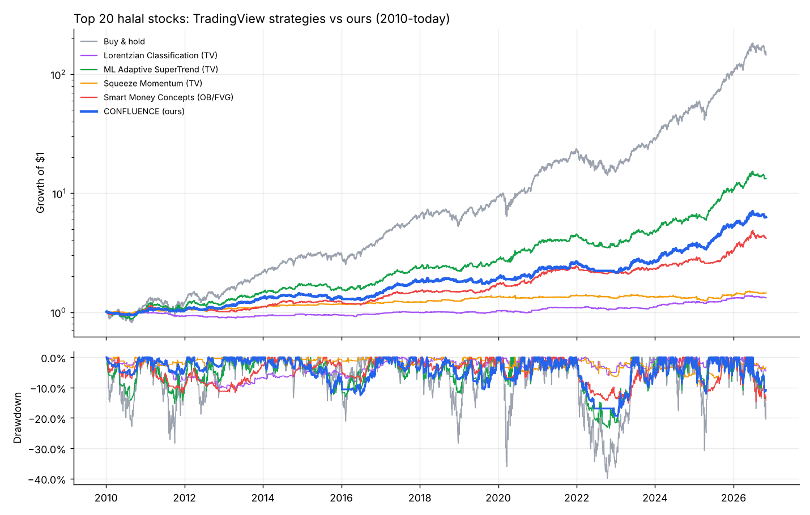
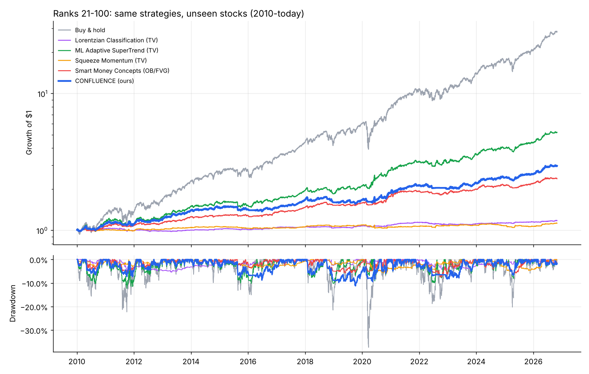
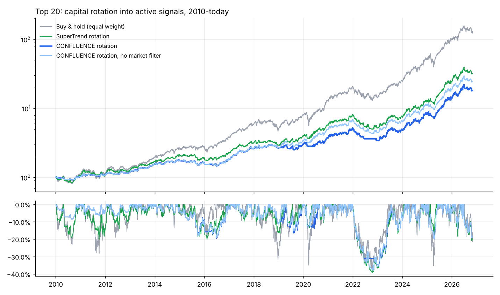
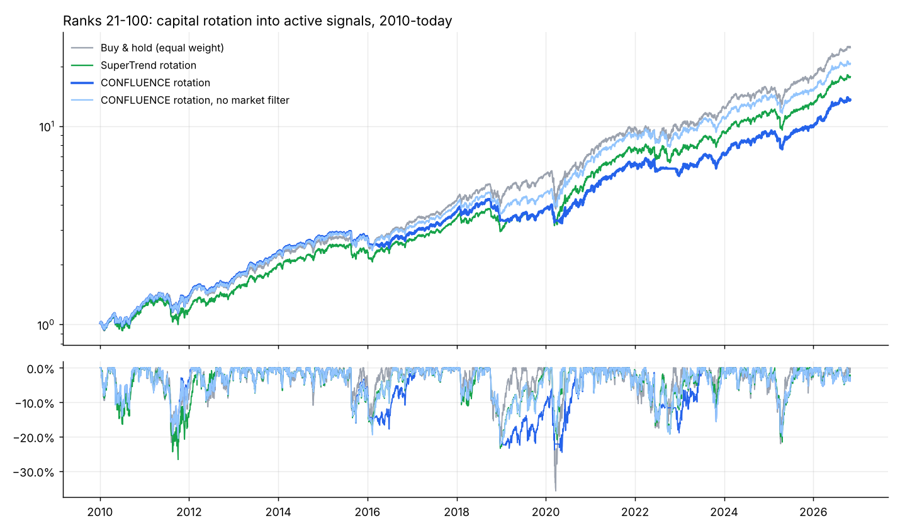

# TradingView indicators vs our strategy on halal stocks

Generated 2026-10-31. Daily bars 2010-today, signals at the close, orders at the next
open, 5 bps per side, long-only (sell signals = go to cash). Each stock is an equal slice of the portfolio.
Cells: **CAGR / Sharpe / max drawdown**.

> **Big caveat:** the top 20 were picked partly *because* they went up a lot in the last 5 years
> (hindsight). Buy & hold on them looks spectacular and any strategy that spends time in cash will
> trail it in return. Judge strategies on Sharpe and drawdown, and on the ranks 21-100 check.

## Results
### Top 20 halal stocks (the request)

| Strategy | 2010-2018 | 2019-today | 2010-today | Time in market | Trades/stock/yr | Win rate |
|---|---|---|---|---|---|---|
| Buy & hold | 21.3% / 0.98 / -28% | 51.5% / 1.45 / -40% | 34.5% / 1.22 / -40% | 100% |  |  |
| Lorentzian Classification (TV) | -0.2% / -0.05 / -11% | 3.8% / 0.92 / -6% | 1.7% / 0.48 / -11% | 7% | 4.2 | 54% |
| Lorentzian, fixed labels | 0.3% / 0.24 / -4% | 0.8% / 0.33 / -5% | 0.5% / 0.28 / -5% | 3% | 1.9 | 54% |
| ML Adaptive SuperTrend (TV) | 9.4% / 0.80 / -15% | 25.7% / 1.38 / -23% | 16.7% / 1.10 / -23% | 57% | 3.3 | 49% |
| Squeeze Momentum (TV) | 2.4% / 0.77 / -4% | 2.1% / 0.38 / -11% | 2.2% / 0.51 / -11% | 11% | 3.8 | 46% |
| Smart Money Concepts (OB/FVG) | 4.5% / 0.68 / -12% | 14.1% / 1.10 / -15% | 8.9% / 0.90 / -15% | 32% | 1.4 | 30% |
| **CONFLUENCE (ours)** | 6.8% / 0.89 / -13% | 17.3% / 1.23 / -20% | 11.6% / 1.05 / -20% | 40% | 2.5 | 47% |
| ablation: no ML veto | 9.2% / 0.79 / -15% | 21.6% / 1.32 / -23% | 14.8% / 1.06 / -23% | 53% | 3.2 | 47% |
| ablation: no squeeze | 6.5% / 0.91 / -12% | 17.1% / 1.25 / -19% | 11.3% / 1.07 / -19% | 38% | 2.3 | 47% |
| ablation: no SMC | 5.1% / 0.75 / -13% | 16.1% / 1.26 / -16% | 10.1% / 1.02 / -16% | 36% | 2.2 | 48% |
| ablation: no market filter | 6.8% / 0.89 / -12% | 20.3% / 1.30 / -20% | 12.9% / 1.09 / -20% | 43% | 2.6 | 48% |

### Ranks 21-100 (robustness check - not used in any design decision)

| Strategy | 2010-2018 | 2019-today | 2010-today | Time in market | Trades/stock/yr | Win rate |
|---|---|---|---|---|---|---|
| Buy & hold | 18.1% / 1.03 / -22% | 26.5% / 1.21 / -37% | 22.0% / 1.12 / -37% | 99% |  |  |
| Lorentzian Classification (TV) | 0.4% / 0.25 / -5% | 1.6% / 0.70 / -4% | 1.0% / 0.48 / -5% | 7% | 4.5 | 53% |
| Lorentzian, fixed labels | -0.0% / -0.01 / -2% | 0.2% / 0.19 / -3% | 0.1% / 0.10 / -3% | 3% | 2.2 | 52% |
| ML Adaptive SuperTrend (TV) | 7.1% / 0.80 / -12% | 14.1% / 1.32 / -10% | 10.3% / 1.06 / -12% | 57% | 3.5 | 46% |
| Squeeze Momentum (TV) | 0.7% / 0.35 / -4% | 0.7% / 0.24 / -6% | 0.7% / 0.29 / -6% | 11% | 4.4 | 43% |
| Smart Money Concepts (OB/FVG) | 4.8% / 1.00 / -6% | 5.9% / 1.00 / -8% | 5.3% / 0.99 / -8% | 29% | 1.5 | 31% |
| **CONFLUENCE (ours)** | 5.4% / 0.80 / -9% | 8.2% / 1.06 / -8% | 6.7% / 0.93 / -11% | 43% | 2.8 | 44% |
| ablation: no ML veto | 6.0% / 0.71 / -12% | 10.2% / 1.14 / -10% | 7.9% / 0.91 / -12% | 53% | 3.4 | 44% |
| ablation: no squeeze | 5.0% / 0.79 / -9% | 7.7% / 1.06 / -8% | 6.2% / 0.92 / -11% | 40% | 2.7 | 44% |
| ablation: no SMC | 4.9% / 0.77 / -9% | 7.2% / 1.04 / -8% | 6.0% / 0.90 / -12% | 40% | 2.6 | 44% |
| ablation: no market filter | 6.2% / 0.89 / -9% | 11.5% / 1.24 / -9% | 8.6% / 1.07 / -9% | 47% | 3.0 | 46% |

## Sharpe ratio per stock (top 20, 2010-today)
Confluence beat buy & hold on Sharpe in 1 of 20 stocks.

| Stock | Buy & hold | Lorentzian | SuperTrend | Squeeze | SMC | CONFLUENCE |
|---|---|---|---|---|---|---|
| MU | 0.78 | 0.03 | 0.39 | 0.26 | 0.79 | 0.44 |
| WDC | 0.57 | 0.15 | 0.55 | 0.20 | 0.41 | 0.27 |
| NVDA | 1.04 | 0.21 | 0.82 | 0.60 | 0.27 | 0.79 |
| STX | 0.79 | 0.48 | 0.68 | 0.52 | 0.28 | 0.63 |
| PLTR | 1.04 | 0.38 | 0.68 | -0.20 | 0.53 | 0.76 |
| LRCX | 0.82 | 0.35 | 0.46 | 0.12 | 0.59 | 0.53 |
| AVGO | 1.05 | 0.21 | 0.75 | 0.19 | 0.46 | 0.49 |
| ANET | 0.91 | 0.36 | 0.32 | -0.19 | 0.28 | 0.26 |
| GEV | 1.60 | 1.06 | 0.62 | 0.45 | -0.18 | 0.72 |
| KLAC | 0.87 | 0.15 | 0.58 | 0.08 | 0.18 | 0.34 |
| APP | 0.67 | 0.34 | 0.86 | 0.06 | 0.13 | 0.88 |
| LLY | 1.05 | -0.18 | 0.59 | 0.67 | 0.49 | 0.57 |
| FIX | 0.89 | -0.24 | 0.76 | -0.09 | 0.45 | 0.53 |
| TER | 0.68 | 0.12 | 0.44 | -0.03 | 0.37 | 0.53 |
| FTNT | 0.83 | -0.25 | 0.64 | 0.30 | 0.46 | 0.52 |
| AAPL | 0.99 | 0.42 | 1.01 | 0.46 | 0.66 | 0.85 |
| HWM | 0.87 | 0.52 | 0.39 | -0.13 | 0.87 | 0.14 |
| AMAT | 0.74 | 0.20 | 0.57 | 0.32 | 0.28 | 0.32 |
| GOOGL | 0.76 | -0.06 | 0.62 | 0.05 | 0.44 | 0.63 |
| APH | 0.89 | 0.70 | 0.56 | 0.10 | 0.32 | 0.25 |

## How each indicator was implemented
See the docstring of `lab/tv.py` for the exact rules. Defaults from the published scripts:
- **Lorentzian Classification**: 5 features (RSI14, WT 10/11, CCI20, ADX20, RSI9), 8 neighbours, 2000 bars,
  volatility + regime + kernel filters, 4-bar holding. "Fixed labels" pairs features with the *next* 4 bars
  instead of the published backward-looking (and inverted) label.
- **ML Adaptive SuperTrend**: ATR10, factor 3, k-means on the last 100 ATR values (75/50/25% initial centroids).
- **Squeeze Momentum**: BB 20 / KC 20 x1.5; enter on squeeze release with positive rising momentum, exit when
  momentum turns down.
- **Smart Money Concepts**: 10-bar swing pivots, BOS/CHoCH, order block = lowest candle between the broken
  swing high and the break, FVG with auto threshold; buy a retest of the zone in bullish structure and the
  discount half; stop on a close below the zone or a bearish structure break.
- **Confluence (ours)**: SuperTrend regime + any of {SuperTrend flip, squeeze release, OB/FVG retest} as entry,
  Lorentzian (fixed) as a veto, market bear filter, exit on SuperTrend flip or bearish CHoCH.

## Second attempt: rotate capital into active signals (no idle sleeves)
Equal weight across all stocks whose signal is ON, max 10% per stock, rest in cash. Rules fixed before running; designed after seeing the first results (see `run_tv_rotation.py`).

### Top 20

| Strategy | 2010-2018 | 2019-today | 2010-today | Avg invested |
|---|---|---|---|---|
| Buy & hold (equal weight) | 19.8% / 0.91 / -32% | 50.4% / 1.41 / -38% | 33.2% / 1.17 / -38% | 100% |
| SuperTrend rotation | 12.8% / 0.80 / -20% | 35.6% / 1.36 / -39% | 22.9% / 1.09 / -39% | 80% |
| CONFLUENCE rotation | 11.7% / 0.98 / -20% | 27.7% / 1.22 / -35% | 18.9% / 1.08 / -35% | 62% |
| CONFLUENCE rotation, no market filter | 11.7% / 0.97 / -19% | 32.5% / 1.30 / -38% | 20.9% / 1.12 / -38% | 66% |

### Ranks 21-100

| Strategy | 2010-2018 | 2019-today | 2010-today | Avg invested |
|---|---|---|---|---|
| Buy & hold (equal weight) | 17.4% / 0.99 / -23% | 25.4% / 1.18 / -36% | 21.1% / 1.08 / -36% | 100% |
| SuperTrend rotation | 13.0% / 0.83 / -27% | 25.5% / 1.32 / -22% | 18.7% / 1.07 / -27% | 99% |
| CONFLUENCE rotation | 14.4% / 0.92 / -23% | 19.6% / 1.14 / -20% | 16.8% / 1.03 / -25% | 94% |
| CONFLUENCE rotation, no market filter | 15.5% / 0.97 / -23% | 24.9% / 1.30 / -20% | 19.8% / 1.13 / -23% | 98% |

## Verdict
1. **Lorentzian Classification and Squeeze Momentum have no usable edge on daily halal stocks.** They are in
   the market 3-11% of the time, hold for days, and earn ~1-2%/yr as standalone strategies. Fixing the
   Lorentzian label bug (training on the *next* 4 bars) did not help: the kNN signal is close to noise.
2. **ML Adaptive SuperTrend is the best of the four**, as a pure trend filter: about half of buy & hold's
   drawdown with a similar Sharpe, but much lower return when it sits in cash.
3. **Smart Money Concepts** (OB/FVG retests in bullish structure) is a low-risk, low-exposure strategy:
   Sharpe ~0.9-1.0, drawdowns under 15%, but only ~30% win rate and small returns on its own.
4. **Our Confluence strategy** combined them, but in the first test it did NOT beat SuperTrend alone. The ML
   veto cut returns and the market filter hurt (ablations above).
5. **The real fix was portfolio construction, not more indicators:** rotating capital into the stocks whose
   signal is ON (instead of leaving each stock's slice in cash) brought returns close to buy & hold. On ranks
   21-100, Confluence rotation without the market filter: **19.8%/yr, Sharpe 1.13, max drawdown -23%** vs buy &
   hold 21.1%, 1.08, -36%.
6. On the hand-picked top 20, buy & hold wins on return (33%/yr) - unsurprising, since those stocks were
   chosen for their past 5-year gains. No timing strategy can be expected to beat hindsight.

Bottom line: the indicators are useful as **risk control** (smaller crashes at a similar Sharpe), not as a
way to make more money than holding the stocks. This matches the earlier research (reports/RESEARCH_NOTES.md).
