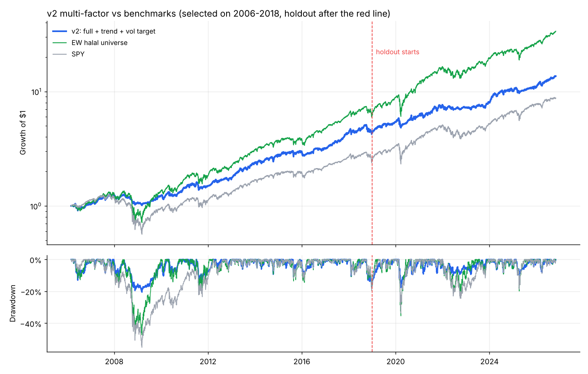

# v2 Multi-Factor Results

Generated 2026-10-30. 128 halal stocks, daily data to 2026-10-29,
5 bps/side costs, signals at close, trades next close.

## Selected strategy: J  full + trend + vol target
Chosen **only** on 2006-2018 Sharpe out of 14 pre-registered variants
(deflated Sharpe on that period: 1.00). 2019-today was not used for any decision.

### Holdout 2019-today (never seen during selection)
| Series | CAGR | Sharpe | Max DD | Volatility | Turnover/yr |
|---|---|---|---|---|---|
| v2 selected | 15.5% | 1.13 | -17.6% | 13.6% | 3.8x |
| EW halal universe | 23.6% | 1.13 | -35.4% | 20.7% | |
| SPY | 17.1% | 0.92 | -33.7% | 19.1% | |

Sharpe difference vs EW halal universe, 95% bootstrap CI: holdout [-0.47, +0.46],
full period [-0.17, +0.36]. If the interval contains 0, the edge is not statistically proven.

### Full period 2006-today
| Series | CAGR | Sharpe | Max DD | Volatility | Turnover/yr |
|---|---|---|---|---|---|
| v2 selected | 13.5% | 1.03 | -20.5% | 13.1% | 3.8x |
| EW halal universe | 18.6% | 0.94 | -47.8% | 20.4% | |
| SPY | 11.1% | 0.64 | -55.2% | 19.2% | |

## All variants (CAGR / Sharpe / Max DD per period)
| Variant | 2006-2011 (GFC) | 2012-2018 | 2019-today HOLDOUT | Turnover/yr |
|---|---|---|---|---|
| A  momentum only, top10 equal (v1-style) | 5.4% / 0.33 / -47.2% | 26.8% / 1.34 / -26.5% | 29.3% / 1.05 / -28.7% | 7.8x |
| B  core: mom+resid+52wk+lowvol | 5.5% / 0.37 / -41.3% | 18.0% / 1.32 / -18.1% | 17.7% / 1.04 / -30.1% | 3.1x |
| C  core + overnight | 5.6% / 0.37 / -43.8% | 19.0% / 1.33 / -20.2% | 20.1% / 1.10 / -31.3% | 3.1x |
| D  core + earnings drift | 5.8% / 0.38 / -43.3% | 18.4% / 1.33 / -18.7% | 18.1% / 1.04 / -30.9% | 3.5x |
| E  full (core + overnight + earnings) | 5.9% / 0.38 / -44.0% | 18.8% / 1.30 / -21.2% | 19.9% / 1.07 / -31.4% | 3.4x |
| F  full, sector-neutral scores | 4.5% / 0.31 / -46.8% | 18.8% / 1.29 / -22.2% | 19.8% / 1.03 / -36.0% | 3.5x |
| G  full, buy 4 days before month-end | 4.6% / 0.32 / -44.6% | 19.7% / 1.36 / -20.4% | 19.8% / 1.06 / -31.5% | 3.5x |
| H  full + slow trend overlay (50% floor) | 9.2% / 0.60 / -28.3% | 18.6% / 1.31 / -21.2% | 18.6% / 1.09 / -25.5% | 3.9x |
| I  full + vol target 15% | 6.4% / 0.53 / -24.5% | 17.0% / 1.28 / -17.2% | 15.5% / 1.10 / -17.6% | 3.6x |
| J  full + trend + vol target | 7.1% / 0.59 / -20.5% | 16.9% / 1.29 / -17.2% | 15.5% / 1.13 / -17.6% | 3.8x |
| K  full, top 20 | 4.8% / 0.33 / -45.8% | 19.3% / 1.28 / -21.4% | 17.9% / 0.95 / -32.2% | 3.8x |
| L  full, top 40 | 4.4% / 0.31 / -44.7% | 19.0% / 1.34 / -19.5% | 19.9% / 1.08 / -30.9% | 3.0x |
| M  full, equal weight | 6.8% / 0.40 / -45.8% | 20.1% / 1.29 / -21.8% | 21.9% / 1.09 / -31.6% | 3.1x |
| N  momentum family only (mom+resid+52wk+overnight) | 4.6% / 0.31 / -48.7% | 19.7% / 1.28 / -20.8% | 24.1% / 1.16 / -31.6% | 3.5x |
| EW halal universe | 10.8% / 0.53 / -47.8% | 19.7% / 1.31 / -19.5% | 23.6% / 1.13 / -35.4% | 0.0x |
| SPY | 1.8% / 0.19 / -55.2% | 12.6% / 0.99 / -19.3% | 17.1% / 0.92 / -33.7% | 0.0x |

## Ablation: Sharpe lost when removing one signal from the full model
Positive = the signal helps. A signal earns its place only if it helps in most periods.

| Signal removed | 2006-2011 (GFC) | 2012-2018 | 2019-today HOLDOUT |
|---|---|---|---|
| mom | +0.09 | -0.09 | +0.06 |
| resid | +0.09 | -0.07 | +0.04 |
| high52 | +0.02 | -0.03 | +0.02 |
| lowvol | +0.05 | -0.02 | -0.03 |
| overnight | +0.00 | -0.04 | +0.03 |
| ear | +0.01 | -0.03 | -0.02 |

## Year by year (selected strategy)
| Year | v2 | EW halal | SPY |
|---|---|---|---|
| 2006 | 3.1% | 6.3% | 12.5% |
| 2007 | 21.4% | 19.9% | 5.1% |
| 2008 | -14.8% | -31.1% | -36.8% |
| 2009 | 14.7% | 52.9% | 26.4% |
| 2010 | 16.8% | 26.9% | 15.1% |
| 2011 | 4.3% | 7.0% | 1.9% |
| 2012 | 15.5% | 20.2% | 16.0% |
| 2013 | 39.5% | 42.1% | 32.3% |
| 2014 | 15.4% | 19.0% | 13.5% |
| 2015 | 6.8% | 3.0% | 1.2% |
| 2016 | 6.4% | 22.6% | 12.0% |
| 2017 | 37.1% | 32.8% | 21.7% |
| 2018 | 2.6% | 3.1% | -4.6% |
| 2019 | 22.2% | 38.2% | 31.2% |
| 2020 | 14.0% | 33.6% | 18.3% |
| 2021 | 23.7% | 38.7% | 28.7% |
| 2022 | -5.0% | -10.6% | -18.2% |
| 2023 | 12.4% | 34.4% | 26.2% |
| 2024 | 23.0% | 12.2% | 24.9% |
| 2025 | 8.1% | 17.7% | 17.7% |
| 2026 | 25.7% | 29.1% | 13.6% |

## Current holdings
- NSC: 5.7% (Industrials)
- KO: 5.6% (Consumer Defensive)
- UNP: 5.6% (Industrials)
- CSX: 5.6% (Industrials)
- JNJ: 5.4% (Healthcare)
- GWW: 5.3% (Industrials)
- CVX: 4.9% (Energy)
- XOM: 4.5% (Energy)
- GILD: 4.4% (Healthcare)
- ROST: 4.3% (Consumer Cyclical)
- AAPL: 4.2% (Technology)
- COP: 4.0% (Energy)
- PSX: 3.6% (Energy)
- NUE: 3.5% (Basic Materials)
- MPC: 3.2% (Energy)
- MRK: 3.1% (Healthcare)
- VLO: 2.9% (Energy)
- GOOGL: 2.6% (Communication Services)
- AMZN: 2.5% (Consumer Cyclical)
- APH: 2.5% (Technology)
- CAT: 2.5% (Industrials)
- KEYS: 2.4% (Technology)
- ABNB: 2.2% (Consumer Cyclical)
- FCX: 2.2% (Basic Materials)
- AMD: 1.5% (Technology)
- CRWD: 1.4% (Technology)
- MU: 1.2% (Technology)
- DELL: 1.2% (Technology)
- INTC: 1.1% (Technology)
- TER: 1.0% (Technology)
