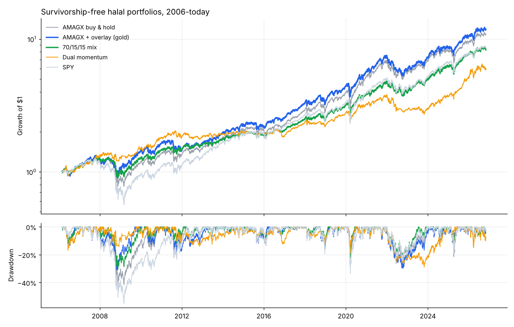

# v3 Survivorship-free halal multi-asset tests

Generated 2026-10-30. Data to 2026-10-30. Cells are CAGR / Sharpe / Max drawdown. 5 bps per side costs.

## Experiment 1 - risk overlay on a real Shariah fund (AMAGX, 2006-today)
Rule: same slow trend filter + 20% vol target as v2. Pass = max drawdown at least 30% smaller and Sharpe no more than 0.05 lower, holding in both halves.

| Strategy | 2006-2012 | 2013-today | 2006-today |
|---|---|---|---|
| AMAGX buy & hold | 6.6% / 0.43 / -42% | 15.4% / 0.92 / -28% | 12.2% / 0.73 / -42% |
| AMAGX + overlay, 0% cash | 6.7% / 0.51 / -22% | 13.6% / 0.95 / -23% | 11.4% / 0.81 / -23% |
| AMAGX + overlay, freed weight in gold | 7.0% / 0.49 / -31% | 15.5% / 1.03 / -30% | 12.7% / 0.84 / -31% |

- **AMAGX + overlay, 0% cash: PASS** (drawdown -42% -> -23%, Sharpe 0.73 -> 0.81)
- **AMAGX + overlay, freed weight in gold: FAIL** (drawdown -42% -> -31%, Sharpe 0.73 -> 0.84)

### Same overlay on Shariah ETFs, 2021-today (after one year of warm-up)
| Strategy | 2021-today |
|---|---|
| SPUS buy & hold | 16.9% / 0.92 / -28% |
| SPUS overlay, 0% cash | 15.5% / 0.97 / -25% |
| SPUS overlay, sukuk | 15.5% / 0.97 / -27% |
| SPUS overlay, gold | 17.3% / 1.04 / -31% |
| HLAL buy & hold | 15.2% / 0.90 / -23% |
| HLAL overlay, 0% cash | 12.7% / 0.86 / -23% |
| HLAL overlay, sukuk | 12.9% / 0.87 / -24% |
| HLAL overlay, gold | 14.9% / 0.95 / -28% |

## Experiment 2 - static mix: 70% halal US equity, 15% gold, 15% sukuk (yearly rebalance)
Before 2020 the sukuk slice is 0% cash. Pass = Sharpe at least +0.10 vs 100% equity and max drawdown no worse than -35%.

| Strategy | 2006-2012 | 2013-today | 2006-today |
|---|---|---|---|
| 100% halal US equity | 6.3% / 0.41 / -42% | 16.3% / 0.95 / -31% | 12.8% / 0.75 / -42% |
| 70 / 15 / 15 mix | 7.3% / 0.57 / -30% | 12.7% / 1.01 / -23% | 10.8% / 0.85 / -30% |

- **FAIL** (Sharpe 0.75 -> 0.85, drawdown -42% -> -30%)

## Experiment 3 - dual momentum: US / international / REIT / gold, top 2 by 12-month return, negative momentum -> sukuk (0% cash before 2020)
Fixed in advance: 12-month lookback, hold 2, monthly. Pass = Sharpe at least +0.10 vs experiment 2 in both eras and max drawdown no worse.

| Strategy | 2006-2019 (proxy era) | 2020-today (real ETFs) | 2006-today |
|---|---|---|---|
| 70/15/15 mix | 8.7% / 0.76 / -30% | 15.2% / 1.00 / -23% | 10.8% / 0.85 / -30% |
| Dual momentum | 7.6% / 0.72 / -17% | 11.6% / 0.76 / -29% | 8.9% / 0.73 / -29% |
| SPY (reference) | 9.1% / 0.56 / -55% | 14.8% / 0.79 / -34% | 11.0% / 0.64 / -55% |

- **FAIL**

## Year by year
| Year | AMAGX buy & hold | AMAGX + overlay (gold) | 70/15/15 mix | Dual momentum | SPY |
|---|---|---|---|---|---|
| 2006 | 12.8% | 12.8% | 10.9% | 8.9% | 12.5% |
| 2007 | 12.2% | 12.2% | 13.1% | 21.2% | 5.1% |
| 2008 | -29.7% | -14.5% | -20.1% | -1.8% | -36.8% |
| 2009 | 32.4% | 32.0% | 25.9% | 14.3% | 26.4% |
| 2010 | 15.9% | 14.3% | 15.6% | 23.0% | 15.1% |
| 2011 | -1.9% | -11.8% | 0.1% | -0.5% | 1.9% |
| 2012 | 11.2% | 12.6% | 8.9% | 1.0% | 16.0% |
| 2013 | 22.8% | 22.8% | 11.7% | 6.0% | 32.3% |
| 2014 | 14.0% | 14.0% | 9.4% | 2.5% | 13.5% |
| 2015 | -0.5% | -3.5% | -2.0% | -1.6% | 1.2% |
| 2016 | 7.5% | 15.2% | 6.5% | -5.9% | 12.0% |
| 2017 | 28.9% | 28.9% | 22.2% | 26.9% | 21.7% |
| 2018 | 2.5% | 3.4% | 1.5% | -4.1% | -4.6% |
| 2019 | 33.1% | 31.2% | 25.6% | 23.6% | 31.2% |
| 2020 | 32.9% | 29.2% | 21.7% | 16.9% | 18.3% |
| 2021 | 31.5% | 31.6% | 24.4% | 16.7% | 28.7% |
| 2022 | -19.5% | -22.4% | -17.0% | -22.2% | -18.2% |
| 2023 | 25.7% | 26.3% | 26.4% | 2.2% | 26.2% |
| 2024 | 15.7% | 16.1% | 23.0% | 22.2% | 24.9% |
| 2025 | 17.6% | 22.9% | 24.3% | 37.7% | 17.7% |
| 2026 | 14.5% | 12.7% | 8.0% | 15.5% | 10.9% |
